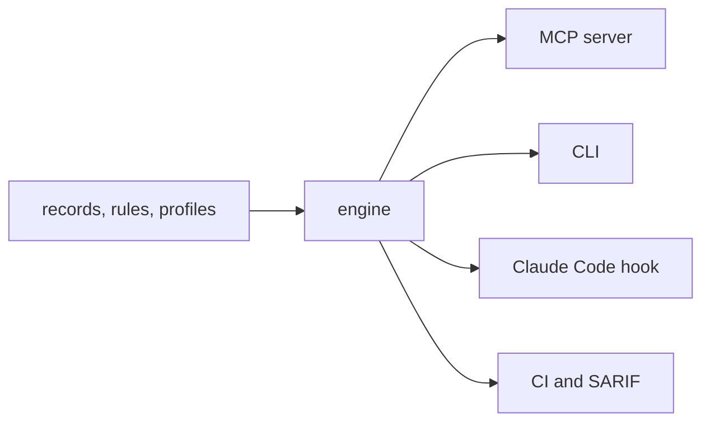

# Concepts

The four ideas behind canon: records, rules, profiles and findings.

## Records

A decision record is a Markdown file with YAML frontmatter in
`canon/records/<scope>/`. It states what you decided, the context that led
there, what it costs, and where it does not apply. Records are the single
source of truth: rules, docs and the "why" in every finding come from them.
The [reference](../reference/records/index.md) lists all 25 shipped records.

Each record has a **strength**: `must` reports as an error, `should` as a
warning, `prefer` as a suggestion.

## Rules

A rule in `canon/rules/rules.yaml` maps a checker's output to a record:

```yaml
- id: golangci-errors
  record: go-errors-wrap
  checker: golangci-lint
  codes: [wrapcheck, errorlint]
  description: golangci-lint with wrapcheck and errorlint enabled
```

A finding is reported only when its checker code matches a rule, which is why
every finding has a reason. `"*"` matches every code from a checker that no more
specific rule claims. Checkers are golangci-lint, ruff, hadolint, tflint,
checkov and yamllint, plus canon's own built-in checks for things they miss
(one cobra command per file, digest-pinned base images, pinned actions, and so on).

## Profiles

A profile detects what kind of repo this is and selects the scopes of records
in force. canon ships six: `go-cli`, `go-service`, `go-library`, `py-service`,
`tf-module` and `generic`.

```yaml
name: go-cli
description: A Go command-line tool built with cobra
priority: 30
detect:
  all: [go.mod, cmd/]
scopes: [go, containers, ci, oss, yaml]
```

Run `canon profile` to see the detected profile, its records and which
checkers are installed. Override detection with `canon check --profile <name>`.

## Findings

Every finding carries a rule, the record it enforces, and why:

```text
Dockerfile:6 error Final stage sets no USER, so it runs as root
  canon-final-stage-user → containers-non-root: A process that escapes a non-root container starts with no privileges on the host.
  fix: USER 65532:65532
```

`why` is the record's `summary`. Findings are available as text, JSON
(`--json`) and SARIF 2.1.0 (`--sarif`). `--min-severity` filters what is
reported and `--fail-on` sets what makes the exit code 1.

## Principles

Every record ladders up to one of seven principles, served as
`canon://principles`. Machines check and people decide: anything checkable
becomes a rule, and judgment goes to people and agents.

## Four front doors



The same engine backs [the MCP server](mcp.md), the CLI, the
[hook and CI](hooks-and-ci.md), so all of them agree.
